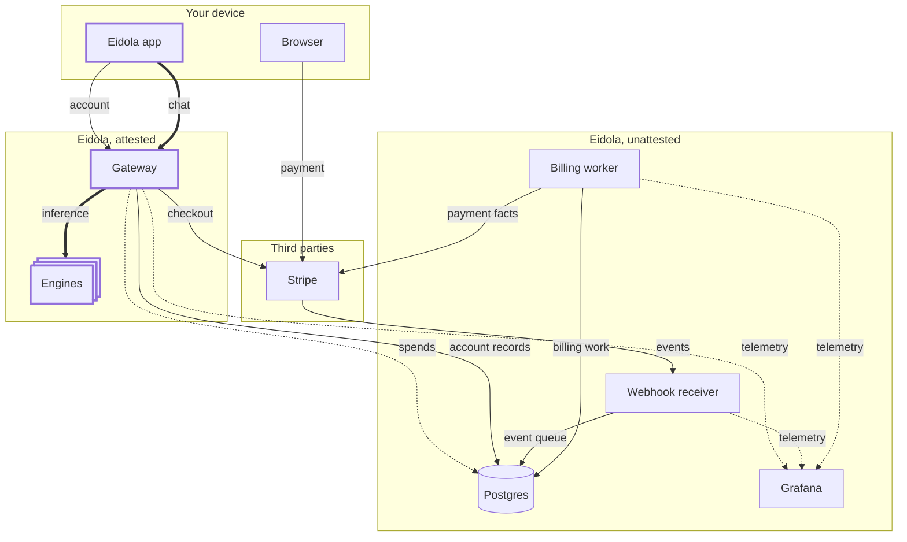

# Architecture

Eidola is composed of several distinct components that function as a complete system. The architecture follows [our paradigm](paradigm.md), ensuring that the pieces operating outside the control of the client are never privy to information that could be used to violate the core privacy goals of Eidola.

## Reading the diagram

- **The boxes are trust boundaries.**
  - *Eidola, attested* code is measured, and its measurement is checked by whoever connects to it, on every connection, before anything is sent.
  - *Eidola, unattested* is the rest of Eidola's service run by Eidola or on its behalf. The app is unable to pin and verify these, so the privacy design treats them as untrusted, sending as little as possible.
  - *Third parties* are services Eidola uses and does not run.
- **A dotted line** carries nothing that can be tied to an account or a person, while **a solid line** carries something that can: prompts and answers, an account's own records, or a payment.
- **A thick line** carries prompts and answers, and **a thick outline** marks a part that sees your prompts and answers.
- **An arrow points away from the side that opens the connection.** Data flows both ways on almost every line.

Each line links to its section below, and each part to the page that describes it.

**Not shown:** connections outside Eidola's service. The app checks for updates at GitHub, and your browser downloads them there. Stripe returns your browser to this website after a payment, and the gateway reads the current terms from it. The app downloads local models from Hugging Face when you ask it to, and sends prompts to any other server you configure yourself, outside everything on this page. The hosting provider runs the machines and the network beneath the attested parts and holds the services' deployment secrets ([vendors.md](vendors.md#infrastructure-inside-the-trust-boundary)). What an observer of several of these networks at once could correlate is a question of its own ([gaps.md](gaps.md#network--metadata)).

## The parts

- **Eidola app** — the GUI and CLI, built on one shared core. It holds your conversations, your account secret and your anonymous credit locally, and it is the only place your account and your requests meet ([client.md](client.md#what-the-client-does-locally-by-design)).
- **Browser** — your own browser, which the app opens for Stripe's checkout and billing pages.
- **Gateway** — the service the app connects to. It runs the account surface and the inference surface side by side and keeps them apart, and it routes each inference request to an engine ([gateway.md](gateway.md#linked-vs-unlinked)).
- **Engines** — Eidola's own inference engine, one model per deployment, in confidential VMs with confidential-computing GPUs ([engine.md](engine.md#where-the-model-runs)).
- **Postgres** — the one shared database, outside every enclave. It holds account and billing records, and one record per spend of anonymous credit that cannot be traced to the account that paid ([anonymous-credits.md](anonymous-credits.md#what-postgres-may-hold)).
- **Webhook receiver** — a small process that accepts Stripe's notifications and queues them.
- **Billing worker** — a process that works through that queue, asks Stripe for the facts behind each notification, and applies purchases, refunds and disputes to the account records ([anonymous-credits.md](anonymous-credits.md#payment-reversals)).
- **Stripe** — the payment processor. It knows who paid, and never sees what was asked.
- **Grafana** — where the gateway and the billing processes send their operational telemetry ([gateway.md](gateway.md#telemetry-scope-and-boundary)).

## The connections

### Chat

The app sends each inference request to the gateway, paid for with anonymous credit, and receives the answer.

**Who can see it.** Your own network, the internet carriers in between, and the hosting provider's network on the way in. The other end is the gateway's measured code.

**What they see.** On the network, encrypted traffic: your IP address, when each request is sent and how large it is, and when each answer starts and how long it runs. Requests are not padded, so their sizes are visible ([gaps.md](gaps.md#passive-traffic-analysis)). Inside its enclave the gateway sees the prompt, the answer and the credit that pays for them. It does not see which account the credit came from.

**What protects it.** TLS ends inside the gateway's enclave, and the app checks the enclave's attestation on every new connection against the identity compiled into it, refusing on any mismatch ([client.md](client.md#per-handshake-attestation-no-caching)). The request carries anonymous credit and no account credentials; a request carrying account credentials is refused ([gateway.md](gateway.md#linked-vs-unlinked)). A streamed answer leaves as fixed-size frames on a fixed tick, and every other response is padded to a size bucket ([gateway.md](gateway.md#response-shape)).

### Account

The app manages its account at the gateway: creating it, accepting terms, converting purchased credit into anonymous credit, and starting a purchase, a visit to the billing portal or a repair.

**Who can see it.** The same network parties as for chat, and the gateway.

**What they see.** On the network, the same as for chat. The gateway sees the account (a random identifier, with no name or email), when it converts credit and how much, the terms it accepted, and its purchase and repair requests. It never sees a prompt here.

**What protects it.** The same attested TLS as chat. Anonymous credit is signed blind: the gateway signs it without seeing it, and cannot recognise it later when it is spent ([anonymous-credits.md](anonymous-credits.md#issuance-blind-signing)). The app converts credit ahead of need, at random times and in one public amount, so a conversion cannot be matched to a later request by time or size ([anonymous-credits.md](anonymous-credits.md#issuance-timing)).

### Inference

The gateway forwards each request to an engine serving the model it names, and relays the answer.

**Who can see it.** The hosting provider, which runs the engine's machine and the network between the two enclaves, and Eidola as operator.

**What they see.** On the network, encrypted traffic: when a request goes, how large it is, and when its answer starts and how long it runs. Requests that share a prefix-cache key go to the same engine, so where they go links them ([privacy-guarantees.md](privacy-guarantees.md#2-unlinkability)). The engine sees the prompt, the answer, the weights it is asked for and the cache key. It never sees a credit, an account or a trace.

**What protects it.** TLS ends inside the engine's confidential VM, and the gateway checks its attestation on every connection against the deployments pinned in the gateway's own measured build. The database records only where engines are, never which to trust ([engine.md](engine.md#what-pins-the-engine)). The engine answers in fixed frames on a fixed tick too, and keeps cached prompt state encrypted between requests under a key derived from the client's.

### Spends

The gateway records each spend of anonymous credit, so that none is spent twice.

**Who can see it.** Whoever can read the database: its host, and anyone holding its credentials.

**What they see.** One record per spend: the key the credit was issued under, a serial number revealed only by spending, and a sealed refund. No account, no amount and no time. The record is written when a request is accepted and again when it ends, so someone watching the database as it changes learns when requests start and how long they run ([gaps.md](gaps.md#spend-timing-at-the-database)).

**What protects it.** Nothing written on the inference path names an account, an amount, a time or any content, or shares a key with the account records ([anonymous-credits.md](anonymous-credits.md#what-postgres-may-hold)). The refund is sealed under a key derived from the client's own secret, which the operator does not hold ([anonymous-credits.md](anonymous-credits.md#sealed-refund-tokens)).

### Account records

The gateway keeps each account and its history.

**Who can see it.** The same as for spends.

**What they see.** Each account's random identifier, a hash of its secret, and its Stripe customer reference; the terms it accepted; one entry per conversion of credit, with the amount and time; queued repair requests; and the gateway's signing keys, encrypted. The gateway also reads here which engines are available.

**What protects it.** No name, email or other personal information is collected. Account records and spend records share nothing to join them by ([privacy-guarantees.md](privacy-guarantees.md#2-unlinkability)).

### Checkout

The gateway asks Stripe for prices, creates the account's Stripe customer, starts checkouts and billing-portal sessions, and reads whether a subscription is in force.

**Who can see it.** Stripe, and the network in between.

**What they see.** Stripe sees the account's identifier, the price chosen, and when. It sees nothing about inference.

**What protects it.** What the gateway sends is fixed by its measured code, and no trace context leaves on any outbound call ([gateway.md](gateway.md#client-directed-tracing)). Stripe can connect an account to the person who paid for it; Eidola's promise is that payment cannot be connected to use ([privacy-guarantees.md](privacy-guarantees.md#8-bounded-claims-what-this-document-does-not-promise)).

### Telemetry

The gateway, the webhook receiver and the billing worker each send operational telemetry to Grafana. The engines open no connections; the gateway reads each engine's figures when it checks on it, and sends them with its own.

**Who can see it.** Grafana, and the network in between.

**What they see.** From the gateway: counts, durations and token totals, aggregated in the enclave over each export interval and labelled only from fixed lists; each engine's totals since it started, labelled by model, deployment and an opaque engine id; a log line for each misconfiguration, engine health change or server error, with its content redacted; and a per-request trace only for a request that asked to be traced. An interval in which a single request fell describes that one request. From the billing processes: counts of Stripe notifications, jobs and calls to Stripe, purchases with their amounts by kind and currency, refunds and disputes, and how much work is waiting.

**What protects it.** Every label comes from a fixed list, and no identifier, account or Stripe text is ever one. Aggregation happens before anything is sent, so nothing per request leaves unless the request asked for it, and a condition that can happen once per request is counted rather than logged ([gateway.md](gateway.md#telemetry-scope-and-boundary)). The billing processes see only the account side, so their telemetry holds nothing about inference.

### Payment

Your browser pays on Stripe's own pages.

**Who can see it.** Stripe, and your network.

**What they see.** Stripe sees who you are as a payer, such as your card and email, and connects that to your account through its customer record.

**What protects it.** No payment detail passes through Eidola. The separation Eidola keeps is between paying and using: Stripe knows who paid, and the gateway cannot tell which account any request came from ([privacy-guarantees.md](privacy-guarantees.md#8-bounded-claims-what-this-document-does-not-promise)).

### Events

Stripe notifies the webhook receiver that something happened to a payment.

**Who can see it.** Stripe, the network, and whatever the operator runs in front of the receiver. The receiver runs outside the attested boundary.

**What they see.** Only which event happened, of what kind, and to which Stripe object. Stripe's notification carries no customer details.

**What protects it.** The receiver verifies each notification's signature before keeping it, and holds no key that could ask Stripe for more.

### Event queue

The receiver queues each notification for the billing worker.

**Who can see it.** Whoever can read the database.

**What they see.** One entry per notification: its identifier, its kind, the Stripe object it concerns and when it arrived. The receiver touches no account and no record of spending.

**What protects it.** It stores identifiers only, so the queue holds nothing Stripe did not already say.

### Billing work

The billing worker applies each queued notification to the account records.

**Who can see it.** Whoever can read the database.

**What they see.** Purchases with the price paid, credit granted, and credit taken back by a refund or a dispute, against the account that bought it.

**What protects it.** The billing processes never read or write spends, their serial numbers or their refunds, so nothing they do can find or recall anonymous credit already converted ([anonymous-credits.md](anonymous-credits.md#payment-reversals)).

### Payment facts

The billing worker asks Stripe what a notification refers to, and acts on it: it reads checkouts, invoices, charges, refunds, disputes and subscriptions, and it issues refunds and cancels subscriptions.

**Who can see it.** Stripe, and the network in between.

**What they see.** Stripe sees which of its own records the worker asks about, and when.

**What protects it.** The worker treats a notification only as a reason to look, and takes every fact from Stripe directly. It holds no webhook secret and accepts no connections.
